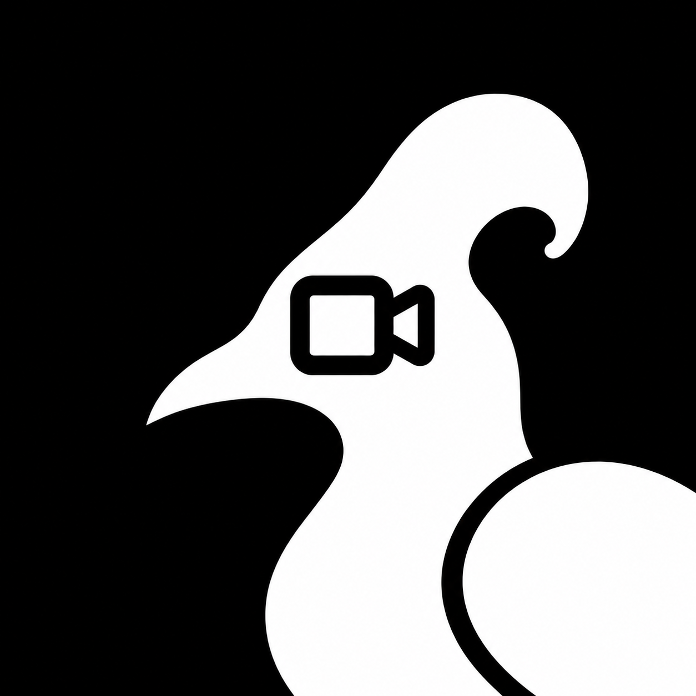

<p align="center"></p>

# Maleo

Maleo turns a content idea into a finished short video. You describe what you
want, an agent drafts a blueprint and storyboard, image and speech providers
generate the media, and a Remotion pipeline renders the result. Everything runs
locally against one Postgres runtime database, embedded in development.

## Quickstart

Requires [Bun](https://bun.sh) 1.3.1 and a supported embedded Postgres platform
(macOS or Linux, arm64 or x64). Node 22.18+ or 24.11+ is needed by the Inngest
CLI installer and by the Vite+ (`vp`) lint and format tooling.

```bash
bun install --frozen-lockfile  # all workspaces and local Inngest CLI
bun run setup                  # root .env, prerequisites, database migrations
bun run dev                    # API, web, Inngest; media worker when configured
```

Then open <http://localhost:3030>.

API requires a session. First account claims the deployment and becomes its
owner; later accounts join through invitations.

`bun run setup` preserves an existing root `.env` and data, runs pending database
migrations, and reports missing optional provider credentials. It exits with a
repair command if required local tooling or database startup fails.

## Next steps

- Running services one at a time, restarting, verifying a change, runtime
  data and the master key: [docs/development.md](docs/development.md)
- Deploying and operating the stack: [docs/self-hosting.md](docs/self-hosting.md)

## Workspaces

| Path                | Package               | Purpose                                           |
| ------------------- | --------------------- | ------------------------------------------------- |
| `apps/web`          | `@maleo/web`          | content-first web client                          |
| `apps/api`          | `@maleo/api`          | HTTP API, chat agent, generation, metering        |
| `packages/db`       | `@maleo/db`           | unified runtime database modules                  |
| `packages/shared`   | `@maleo/shared`       | pure shared types and logic                       |
| `packages/inngest`  | `@maleo/inngest`      | shared durable client and event schemas           |
| `packages/media`    | `@maleo/media`        | media provider abstraction and worker runtime     |
| `apps/media-worker` | `@maleo/media-worker` | deployable shell for the media worker             |
| `packages/video`    | `@maleo/video`        | Remotion video render pipeline                    |
| `packages/stock`    | `@maleo/stock`        | stock media lookup                                |
| `deploy`            | —                     | core deployment stack; see `docs/self-hosting.md` |

Every package is private. Nothing here is published to a registry; the version
in the root `package.json` is the one canonical version for the whole repository.

## Documentation

| Where                    | What it covers                                                |
| ------------------------ | ------------------------------------------------------------- |
| `README.md`              | quickstart and where to go next                               |
| `docs/development.md`    | running, verifying, runtime data, and the master key locally  |
| `docs/self-hosting.md`   | operating a deployment: env, media store, backup, recovery    |
| `docs/coolify.md`        | deploying on Coolify                                          |
| `CONTRIBUTING.md`        | how to participate, and the release workflow                  |
| `AGENTS.md`              | rules for coding agents working in this repository            |
| `openspec/`              | change proposals, specs, and implementation tasks             |
| `docs/decisions/`        | accepted architecture decisions, and why a road was not taken |
| `docs/CODEMAPS/`         | current architecture maps                                     |
| `SECURITY.md`            | reporting a vulnerability privately                           |
| `PRIVACY.md`             | local storage, outbound provider data, and hosting boundary   |
| `THIRD_PARTY_NOTICES.md` | dependency, model, service, font, asset, and provider terms   |

## License

Maleo-owned source and repo-authored assets are MIT licensed. See `LICENSE`.
Dependencies, models, container images, provider services, and returned media
keep their own terms; see `THIRD_PARTY_NOTICES.md`.
